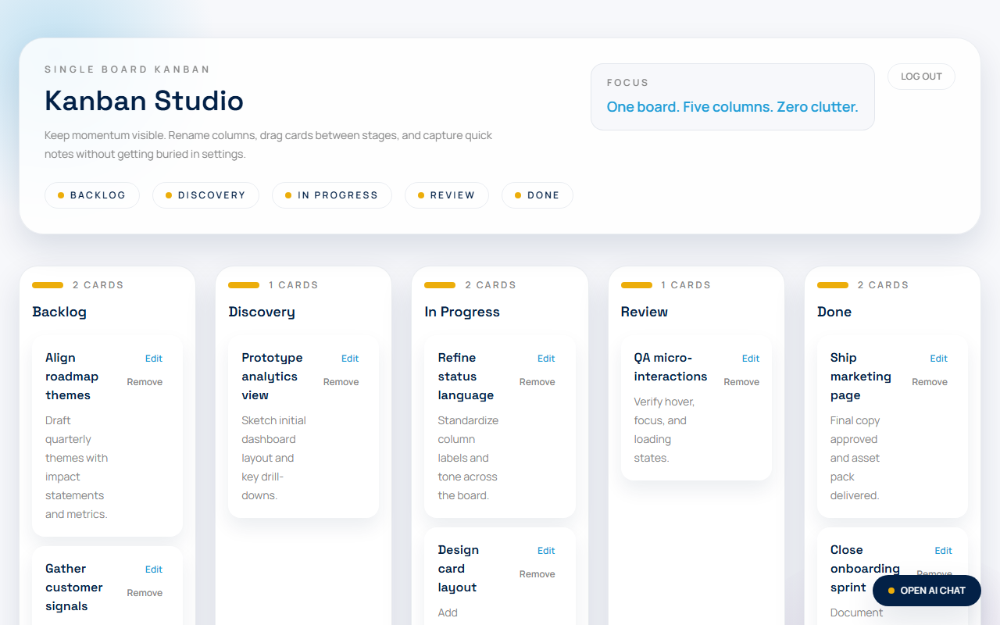
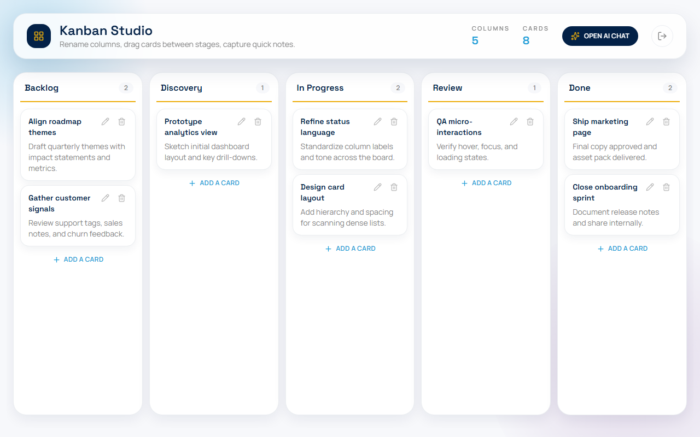
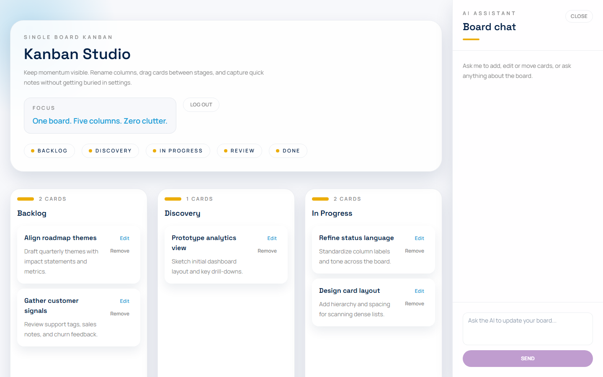
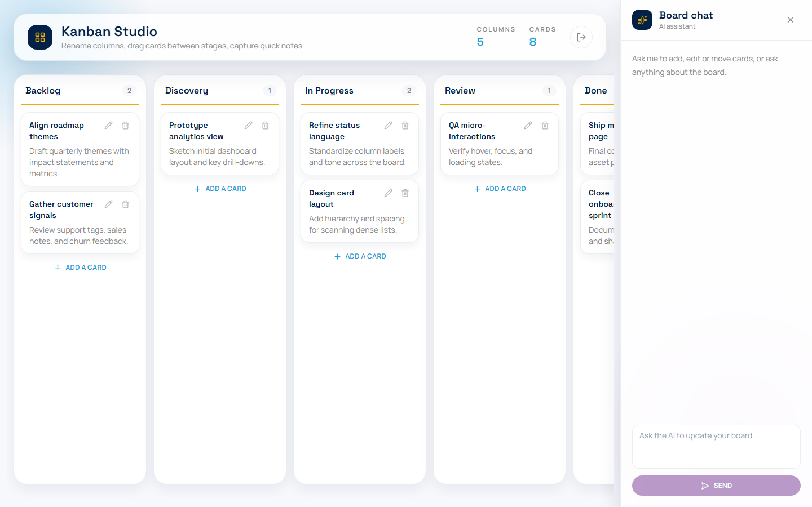
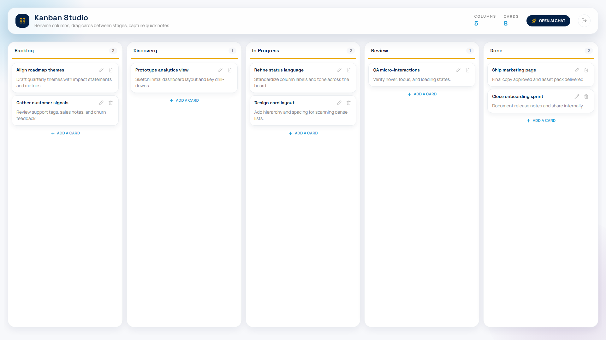
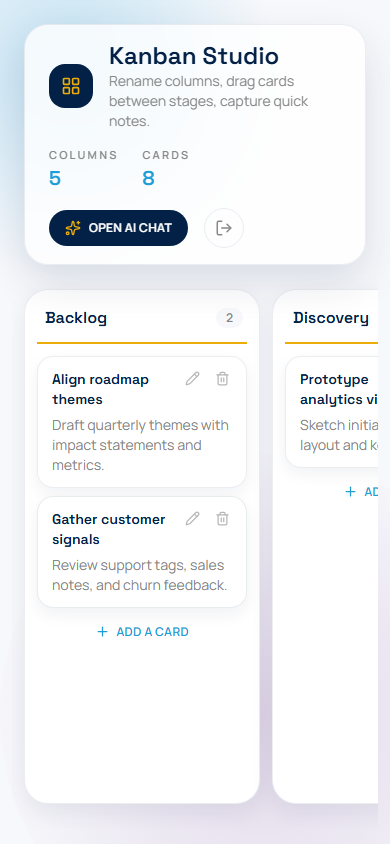

# UI Improvement Report

Date: 2026-10-28. Scope: frontend only. No backend, API or data changes.

## Outcome

All tests pass. The app is running at http://localhost:8000 (container `pm-app`, rebuilt with these changes).

| Suite | Result |
| --- | --- |
| Frontend unit (Vitest) | 43 passed (1 new) |
| Frontend e2e (Playwright, against the container) | 15 passed (5 new) |
| Backend (pytest) | 26 passed, 2 skipped |
| TypeScript (`tsc --noEmit`) and ESLint | clean |

The 2 skipped tests are the live OpenRouter tests in `backend/tests/test_chat.py`. They skip themselves when `OPENROUTER_API_KEY` is unset, and pytest was run in a container with no `.env`, so no OpenRouter calls were made. Every other chat test is mocked (backend: `monkeypatch`; frontend: `mockApi` and Playwright `page.route`).

## Problems found

Measured from screenshots of the previous build:

- The header took about 40% of the first screen (title, tagline, a "Focus" box, and a row of pills repeating the column names).
- Each card kept a column for the Edit and Remove text buttons, so titles and details wrapped into narrow strips of 2-3 words per line.
- With the chat open, the board wrapped into 3 columns plus 2 below, so Review and Done were off-screen.
- The board was capped at 1500px, leaving unused space on wide screens. Columns had a fixed 520px height regardless of the window.
- The floating "Open AI chat" button covered the bottom of the last column.

## Changes

Layout (`KanbanBoard.tsx`)
- Header is one compact row: logo mark, title and one-line tagline on the left; Columns and Cards totals, the "Open AI chat" button and an icon Log out button on the right. The duplicate column pills and the Focus box are gone.
- The 5 columns are always one row. They share the full width (`minmax(236px, 1fr)`) and fill the remaining window height. When the window is too narrow (for example 1440px with the chat open), the board scrolls sideways inside itself; the page itself never scrolls horizontally.
- "Open AI chat" moved from a floating button into the header, so nothing covers the board.

Icons (new dependency `lucide-react`)
- Card Edit and Remove are pencil and trash icon buttons beside the title. They are dimmed until the card is hovered, so cards read cleanly. Card text now uses the full card width.
- Log out, Close chat, Add a card, Send and Open AI chat use icons. Icon-only buttons keep their `aria-label` and a `title` tooltip.

Columns and cards
- Column header: editable title and a count badge on one line, with the yellow accent as an underline.
- "Add a card" sits directly under the last card instead of at the bottom of the column.
- Cards are tighter (smaller padding, a thin border, a blue border on hover, grab cursor). The drag preview is tilted slightly and matches the column width.
- Chat sidebar header is compact (icon, "Board chat", close icon); width 360px to 340px. Thin scrollbars app-wide.

Small screens
- At 390px the header wraps cleanly and the board scrolls sideways one column at a time, with no page overflow.

## Defects found and fixed during testing

1. Columns did not fill the window height. Measured in the browser: the `fieldset` (which disables the board while the AI works) was 628px tall but its grid child only 504px. Root cause: Chrome renders a fieldset's children through an anonymous content box, so flex height does not reach them. Fix: the fieldset is `display: contents`; it still disables its controls, now covered by a new e2e test.
2. A gray band showed under the columns. Root cause: the horizontal scroll container clipped the column shadows. Fix: the scroll area has padding with a matching negative margin, and column shadows are softer.
3. The new board-lock e2e test first failed with a strict-mode error. Root cause: the draggable card has `role="button"` and its accessible name includes the child button labels, so an unscoped locator matched two elements. Fix: the test scopes the locator to the card (a test fix, not a product bug; noted in `frontend/AGENTS.md`).

## New tests

- `frontend/tests/layout.spec.ts`
  - columns are in one row, span the full width and fill the height (1440x900)
  - with the chat open the columns stay in one row, the board scrolls to the last column, and the page does not overflow
  - cards use icon-only edit and delete buttons; deleting with the icon removes the card and updates the count
  - Log out and Close chat are icon-only; Open AI chat hides while the chat is open and returns when it closes
- `frontend/tests/chat.spec.ts`: the board is locked in the browser while the AI is working (mocked, delayed `/api/chat`)
- `frontend/src/components/KanbanBoard.test.tsx`: header totals and column counts update after a delete

## Screenshots

Before, 1280px:

After, 1280px:

Before, 1440px with chat open:

After, 1440px with chat open:

After, 1920px:

After, 390px (phone):

## Notes

- E2e tests reset the stored board. Your board was backed up before testing and restored afterwards.
- Docker Desktop was not running; it was started to run the container and the e2e tests.
- Files changed: `KanbanBoard.tsx`, `KanbanColumn.tsx`, `KanbanCard.tsx`, `KanbanCardPreview.tsx`, `NewCardForm.tsx`, `ChatSidebar.tsx`, `globals.css`, `package.json`, tests, and `frontend/AGENTS.md`. Nothing is committed.
